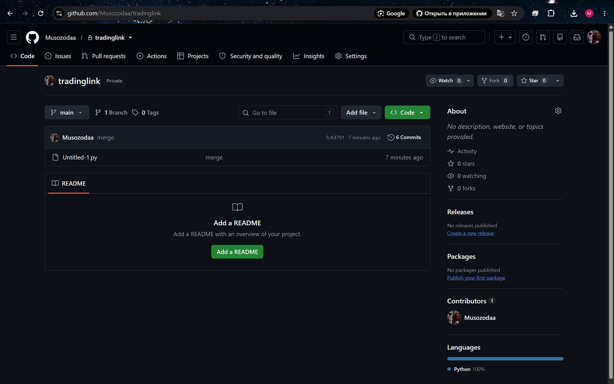
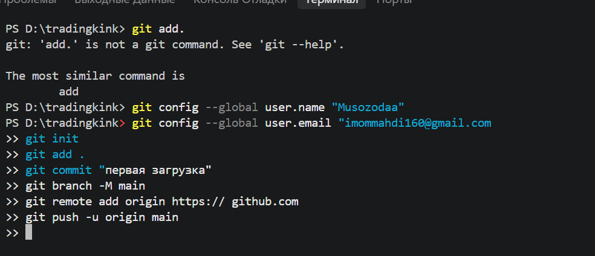
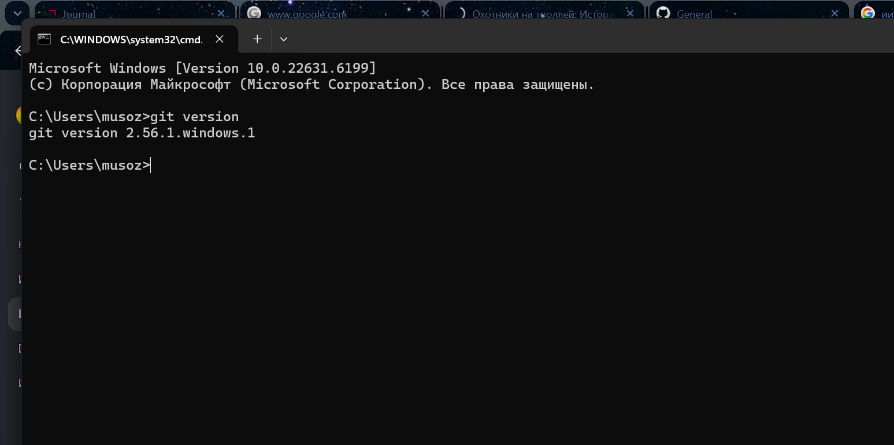

# Отчет по работе с Git и GitHub

## 1. Регистрация на GitHub

## 2. Установка Git и настройка среды

## 3. Подключение локального репозитория и отправка файлов

## 4. Результат в удаленном репозитории

ы